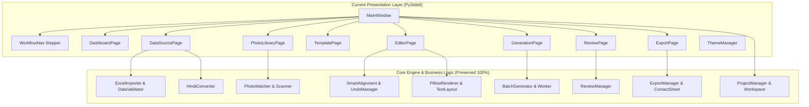

# ID Studio Desktop App: UI/UX Revamp & Migration Plan

> [!NOTE]
> **Stitch Project:** `ID Studio Desktop App` (`projects/3558375394549073475`)  
> **Target Framework:** PySide6 (Qt for Python 6.12+)  
> **Git Branch:** `feature/new-stitch-ui`  
> **Status:** Architecture & Implementation Plan Approved for Execution

---

## 1. Executive Summary & Design Vision

The current desktop application provides robust business logic for batch ID card generation: multi-threaded Pillow rendering, Excel/CSV ingestion, Hindi transliteration (KrutiDev/Chanakya/Mangal), smart alignment, photo matching, and project workspace management. However, its visual interface relies on a linear 7-step wizard layout with generic Fluent forms and disjointed settings.

The **ID Studio Desktop App** redesign elevates the application into an **ultra-dense, high-precision desktop workstation suite** inspired by professional creative tools (Figma, Adobe InDesign/After Effects) and enterprise Windows CAD software. 

### Core Design System Foundations (from Stitch Design MD)

```
┌────────────────────────────────────────────────────────────────────────┐
│ ID STUDIO DESIGN SYSTEM PALETTE (Charcoal Value Ramp)                  │
├────────────────────────────────────────────────────────────────────────┤
│ Canvas Inset (Level 0)       : #0C0E12 (surface-container-lowest)      │
│ Workspace Shell (Level 1)    : #111317 (surface / background)          │
│ Docked Panels / Sidebars     : #1A1C20 (surface-container-low)         │
│ Group Containers / Cards     : #1E2024 (surface-container)             │
│ Elevated Surfaces / Menus    : #282A2E (surface-container-high)        │
│ Active / Hover Highlights    : #333539 (surface-container-highest)     │
│ Hairline Borders & Dividers  : #383D47 / #444653 (outline-variant)     │
│ Primary Accent & Selection   : #6C8CFF (primary-container) / #B6C4FF   │
│ Semantic Success / Ready     : #49B883 / #6EDBA3 (tertiary)            │
│ Semantic Warnings & Overflows: #E8B65B (warning)                       │
│ Semantic Critical / Errors   : #E36D75 / #FFB4AB (error)               │
├────────────────────────────────────────────────────────────────────────┤
│ TYPOGRAPHY: Inter (UI Chrome & Labels) | JetBrains Mono (Coordinates) │
└────────────────────────────────────────────────────────────────────────┘
```

---

## 2. Codebase Architecture & Feature Inventory

Before refactoring the presentation layer, the application's underlying logic, models, and workers must remain completely backward-compatible.

### Current Architecture Decomposition



### Existing Features & Invariants
1. **Workspace Persistence (`ProjectManager`)**: Workspace folder containing `project.json`, `data/`, `photos/`, `templates/`, and `output/`. Supports auto-saving, dirty state tracking, and relinking missing assets.
2. **Data Pipeline (`ExcelImporter`, `HindiConverter`, `DataValidator`)**: Multi-sheet workbook reading, custom header row offset, automatic detection and conversion of legacy Hindi fonts (KrutiDev010, Chanakya, Mangal Unicode), and row-level validation reports.
3. **Photo Ingestion (`PhotoMatcher`, `PhotoIndexingWorker`)**: Background directory scanning, threading queue, exact and fuzzy token matching against record fields (ID, Name, Roll No), missing photo policies (`SKIP`, `PLACEHOLDER`, `FAIL`, `BLANK`).
4. **Canvas Scene & Editor (`CanvasScene`, `CanvasItem`, `SmartAlignment`)**: ISO CR80 (85.60 × 53.98 mm) / CR100 / custom dimensions; dynamic text placeholders (`{{token}}`), photo frames with fit modes, vector rectangles/lines, 1D barcodes and 2D QR codes, smart snapping guides with magnetic distance HUDs, and full undo/redo command stack.
5. **Card Rendering Engine (`PillowRenderer`)**: High-fidelity 300/600 DPI rasterization, anti-aliased geometry, HarfBuzz text shaper for complex Devanagari ligatures, and circular/rounded avatar clipping.
6. **Multi-Threaded Generation (`BatchGenerator`, `GenerationWorker`)**: `QThreadPool`-driven batch pipeline with progress callbacks, cancellation tokens, and pre-flight checklist verification.
7. **Quality Review (`ReviewManager`)**: Per-card approval, rejection with reason logging, and filtered review queues.
8. **Imposition & Output (`ExportManager`, `ContactSheet`)**: Single card export (PNG/JPEG) and multi-card sheet imposition (A4/A3 grid, duplex flip on long edge, crop marks, registration crosshairs, and bleed).

---

## 3. Stitch Screen Mapping to Studio Workspaces

Rather than 9 fragmented pages in a stepped wizard, the Stitch design consolidates the application into **5 streamlined, high-efficiency Studio Workspaces** accessed from a persistent Studio Command Bar:

| Stitch Screen & ID | Stitch Screen Title | Current PySide6 Source | New Studio Workspace |
| :--- | :--- | :--- | :--- |
| `c0960262ecc9...` / `f7e3b5e4e269...` | **Project Hub & Onboarding — ID Studio Launcher** | `DashboardPage`, `ProjectDialog` | **Workspace 0: Project Hub & Launcher** (Modal/Landing) |
| `d7118a39931d...` | **Template Designer — Studio Canvas** | `TemplatePage`, `EditorPage`, `ElementInspector`, `LayersPanel` | **Workspace 1: Template Studio & Canvas** |
| `bd2f3aebf3bb...` | **Data Mapping — Excel & CSV Connector** | `DataSourcePage`, `PhotoLibraryPage`, `FieldMappingPanel` | **Workspace 2: Data Mapping & Connector** |
| `6a3b4424b3f2...` & `f3c87d2721a2...` | **Record Preview & Live Data Inspector** / **Bulk Generation Batch Engine** | `GenerationPage`, `ReviewPage` | **Workspace 3: Generate & Preview Inspector** |
| `1c3461c74814...` & `e5e8185926dd...` & `d1f4a84ac92b...` | **Export & Print Layout — A4 Imposition Engine** / **Distribution** | `ExportPage`, `ContactSheet`, `ManifestWriter` | **Workspace 4: Export & Print Imposition Engine** |

---

## 4. Phase-by-Phase Implementation Plan

### Phase 1: Design Tokens, Typography & QSS Architecture
- **Step 1.1: Font Registration**: Embed and register Google Fonts `Inter` (UI weights 400, 500, 600, 700) and `JetBrains Mono` (weights 400, 500) into `QFontDatabase` inside `resource_loader.py` and `app.py`.
- **Step 1.2: Modernized Theme Manager (`ThemeManager`)**:
  - Restructure `ThemeManager` around the Stitch palette tokens:
    - Base: `#111317`, Panels: `#1A1C20`, Cards: `#1E2024`, Hover: `#282A2E`, Borders: `#383D47` / `#444653`.
    - Primary: `#6C8CFF`, Secondary: `#C4C6D1`, Tertiary/Success: `#49B883`, Error: `#E36D75`.
  - Implement reusable QSS component rules:
    - `InputWell`: Inset 24px/28px height numeric inputs with leading uppercase labels (`X`, `Y`, `W`, `H`).
    - `ToolButton`: 28×28px and 36×36px square buttons with active ring and tooltip styling.
    - `StatusPill`: Soft badge pills (`bg-surface-container`, `text-tertiary`, animated pulse dot).
    - `SegmentedSwitch`: Connected 2-way/3-way toggle containers with smooth active selection.
- **Verification**: Run QSS unit tests and ensure clean font rendering across macOS and Windows.

---

### Phase 2: Shell & Persistent Studio Navigation Bar
- **Step 2.1: Top Studio Command Bar (`StudioHeaderBar`)**:
  - Left: Logo icon + "ID Studio" title + `/` + Project file name with dirty indicator dot (`•`) + Undo/Redo/Save icon buttons.
  - Center: Status pill displaying `Auto-saved (Local)` with green pulse indicator.
  - Right: User profile / settings button + Window controls (minimize, maximize, close).
- **Step 2.2: Studio Workspace Ribbon (`StudioNavBar`)**:
  - Replace the old numbered `1. Data Source → 2. Photos...` stepper with the modern Stitch navigation bar:
    1. **Templates** (Template catalog & preset gallery)
    2. **Template Designer** (Visual Studio canvas)
    3. **Data Mapping** (Excel, CSV & photo connector)
    4. **Generate & Preview** (Batch engine & live record preview)
    5. **Export & Print** (A4 Sheet imposition & PDF/X output)
  - Right side utility controls: `Grid (G)` toggle, Zoom level selector (`100%`), `Preview` toggle, and `Help (F1)`.
- **Step 2.3: Project Hub & Launcher (`ProjectHubView`)**:
  - Implement Screen `c0960262ecc9490c8e0015699569d4c7`:
    - Preset template cards: *Corporate Staff Badge (CR80)*, *High-Security Defense ID*, *A4 Multi-Badge Imposition*, *Visitor & Event Pass (CR100)*.
    - Recent project workspaces list with last modified timestamps and path quick-launch.
    - Quick action triggers: *New Blank Project*, *Open Workspace Folder*, *Import Spreadsheet directly*.
- **Verification**: Smooth switching between workspaces without flickering; project state remains persistent across tabs.

---

### Phase 3: Data Mapping & Photo Connector Revamp (Screen `bd2f3aebf3bb`)
- **Step 3.1: 3-Column Workstation Layout**:
  - **Left Panel (280px)**: Detected Template Placeholders list (`{{employee_name}}`, `{{employee_id}}`, `{{photo}}`, etc.) showing mapping status (`Mapped → FullName`, `REQ` vs `OPT` tags, dynamic icon indicators).
  - **Center Panel**: Connected spreadsheet status bar (e.g. `Connected: 1,420 Records | Sheet: 'Employees_Active'`), Auto-Map Columns ("Magic") button, Validate All button, and virtual record table with syntax highlights.
  - **Right Panel (320px)**: Column Mapping Inspector & Transformer:
    - Target placeholder details and required toggle.
    - Source Excel column combobox with type inference (`[String]`, `[Integer]`, `[Image Path]`).
    - Hindi font transliteration options (Auto, KrutiDev to Unicode, Chanakya to Unicode).
    - Photo lookup binding with match statistics (Matched, Missing, Ambiguous).
    - Missing photo policy selector (Skip record, Default avatar placeholder, Fail generation).
- **Verification**: Ingesting test spreadsheets (including Devanagari test files) updates the mapping state seamlessly.

---

### Phase 4: Template Designer Studio Canvas Revamp (Screen `d7118a39931d`)
- **Step 4.1: Sub-Header Canvas Context Bar**:
  - Artboard preset indicator (e.g. `CR80 53.98 × 85.60 mm | PORTRAIT`).
  - Interactive Zoom Controller: `Zoom Out (-)`, editable zoom percentage `150%`, `Zoom In (+)`, `Fit to Screen (Shift+1)`.
  - Snapping toggle button (`Snap: ON`), Bleed overlay button (`Bleed: 3.0mm`), and Metric Rulers button.
  - Live Data Binding toggle with row stepper (`Row 04 / 1420`, Previous/Next record buttons).
  - Instant `Export Test CR80` action button.
- **Step 4.2: 48px Left Vertical Tool Strip (`StudioToolRibbon`)**:
  - Move/Select Tool (`V`), Direct Select (`A`), Dynamic Text Frame (`T`), ID Photo Frame (`I`), Vector Rect (`R`), Dynamic 2D QR Code, 1D Barcode, Insert Token (`P`), Fill/Stroke dual color wells, Hand/Pan Tool (`H`).
- **Step 4.3: Left Elements & Layers Tree Panel**:
  - Hierarchical layer stack with eye visibility toggle, lock/unlock toggle, type icon, layer label, and reorder drag-and-drop.
- **Step 4.4: Center Interactive Canvas Enhancements**:
  - Inset Level 0 background with subtle dot/grid pattern.
  - Physical CR80 card artboard rendering with realistic rounded corners (3.18mm radius).
  - Outer 3.0mm safe bleed dashed line indicator.
  - Magnetic distance measurement HUD overlays between elements (e.g., `12.0 mm` line between photo and text).
- **Step 4.5: 320px Right Property Inspector (`ElementInspector` Revamp)**:
  - Tab 1: **Transform** (X, Y, W, H numeric wells in mm with constrain proportions toggle, rotation angle, corner radius).
  - Tab 2: **Data Binding** (Variable token identifier, source column link, fallback value, overflow behavior: Auto-shrink font size / Truncate ellipsis / Wrap multi-line).
  - Tab 3: **Typography** (Font family picker featuring Inter, JetBrains Mono, Roboto, etc., font weight, size in pt, tracking/letter-spacing, alignment buttons).
  - Tab 4: **Appearance** (Fill color picker, opacity slider, border stroke width & color, drop shadow toggle).
- **Verification**: Editing canvas elements updates properties immediately; undo/redo stack functions correctly.

---

### Phase 5: Generate & Live Preview Inspector Revamp (Screens `6a3b4424b3f2` & `f3c87d2721a2`)
- **Step 5.1: Live Record Inspector (Review & Validation)**:
  - Left column: Virtual record list with search and filter tabs (`All`, `Valid (1416)`, `Warn (4)`, `Err (0)`), warning flags (e.g. *Missing photo - fallback applied*).
  - Center column: High-resolution card preview with zoom, front/back flip switch, and live token evaluation.
  - Right column: Record field editor, photo override button, and single-card approval/rejection toggle.
- **Step 5.2: Production Batch Generation Engine**:
  - KPI telemetry cards: *Total Generated Cards*, *Elapsed / Estimated Time Remaining*, *Disk Output Throughput*, *Threadpool & CPU Core Utilization*.
  - Left panel: Target template lockup, dataset connection, batch scope selector (All vs Custom Range), raster format selection (PDF Vector, PNG 24-bit, JPEG High), file naming token pattern preview (e.g. `{EmpID}_{FullName}.png`).
  - Center panel: Circular multi-core progress ring, speed graph, active worker status.
  - Right panel: Real-time generation event log and error inspector.
- **Verification**: Batch generation running on background threads updates hardware telemetry smoothly without locking the GUI.

---

### Phase 6: Export & Sheet Imposition Engine Revamp (Screens `1c3461c74814`, `e5e8185926dd`, `d1f4a84ac92b`)
- **Step 6.1: Sheet Imposition Workspace**:
  - Left configuration panel:
    1. **Paper Stock**: A4 (210 × 297 mm), A3 Super (305 × 457 mm), US Letter, Custom; Sheet Orientation (Portrait/Landscape), Card Rotation (0°, 90°, 180°), Duplex Flip on Long Edge.
    2. **Grid & Gutters**: Card matrix (e.g. 2 cols × 4 rows = 8 cards/sheet), column gap (Gx), row gap (Gy), Auto-Center & Maximize button.
    3. **Margins & Offsets**: Top, Bottom, Left, Right margins (with linked offset toggle).
    4. **Marks & Pre-Press**: Corner & gutter crop marks (0.15mm), registration crosshairs, 3.0mm bleed raster extension, CMYK calibration color bars & slug text.
    5. **Color & Raster Output**: 300 DPI Press / 600 DPI, ISO Coated v2 (FOGRA39), PDF/X-1a compliancy.
  - Center interactive sheet canvas: Scaled virtual sheet showing placed badges with live crop marks and registration targets.
  - Right summary panel: Imposition metrics, total paper sheets required, paper utilization %, and Generate Print PDF action.
- **Step 6.2: Distribution & Packaging Hub**:
  - 1-click export of individual PNGs/PDFs, imposed print sheets, and audit manifests (JSON/CSV) packaged into workspace `output/` with direct reveal in OS file manager.
- **Verification**: Generated imposition PDF aligns cards accurately with duplex back-to-back registration.

---

### Phase 7: Verification, Automated Testing & Visual Regression
- **Step 7.1**: Run all 158 pytest unit and integration tests across data validation, pillow rendering, smart alignment, project workspaces, and review workflows.
- **Step 7.2**: Launch the application via `main.py` and execute the full end-to-end user workflow:
  1. Open/create project in Project Hub.
  2. Map Excel file with Hindi text columns.
  3. Customize card template with tokens in Template Designer.
  4. Inspect live records in Preview Inspector.
  5. Run batch generation.
  6. Generate imposed A4 PDF sheet in Imposition Engine.
- **Step 7.3**: Verify responsive window resizing down to 1280×800 and scaling up to 4K displays.

---

## 5. Risk Assessment & Mitigations

| Risk | Impact | Mitigation Strategy |
| :--- | :--- | :--- |
| **High QSS complexity causing styling lag** | Medium | Compile style tokens once in `ThemeManager` with cached strings; use object properties (`setProperty("active", True)`) for dynamic states instead of string concatenation. |
| **Canvas DPI scaling distortion on multi-monitor setups** | Medium | Utilize Qt's logical device independent pixels for geometry coordinates and keep DPI raster scaling localized to the `PillowRenderer` export pipelines. |
| **Breaking existing project files (`project.json`)** | High | Preserve all existing model schemas in `id_card_generator.core.models` intact; only add optional presentation/imposition metadata fields with default fallbacks. |
| **Devanagari text ligature corruption** | Critical | Retain existing `HindiConverter` transliteration pipeline and HarfBuzz text shaping inside `TextLayout` without modification. |
